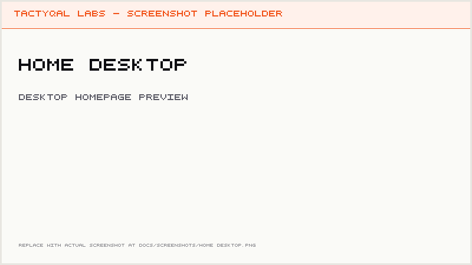
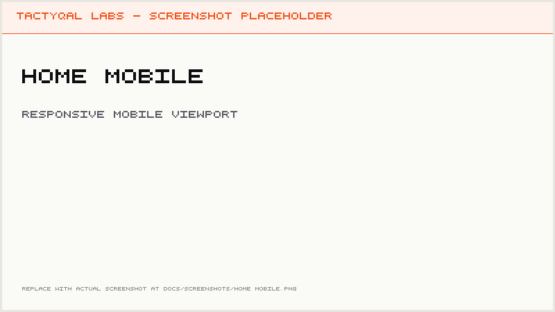
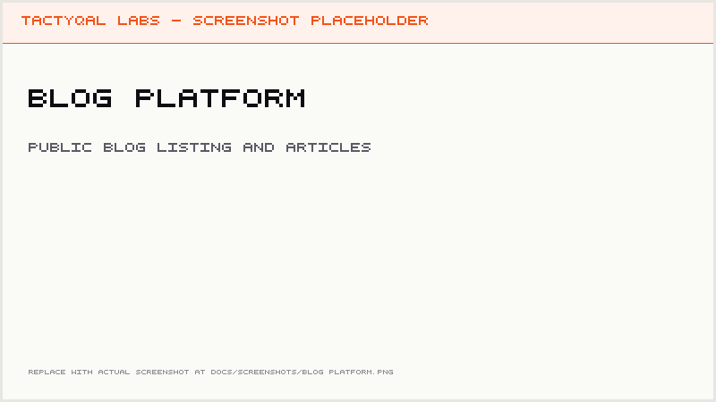
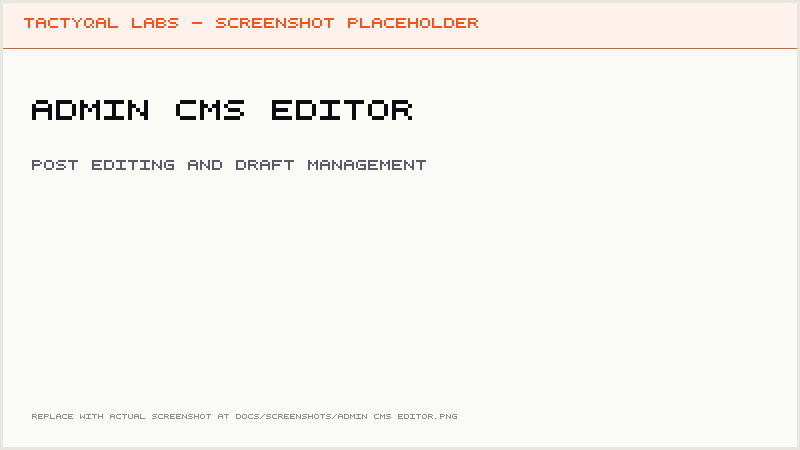
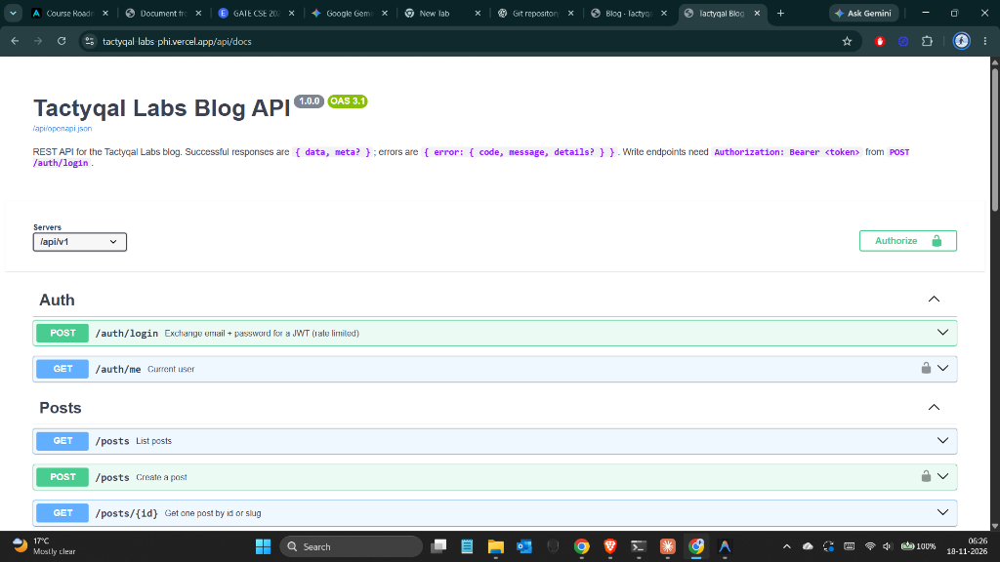
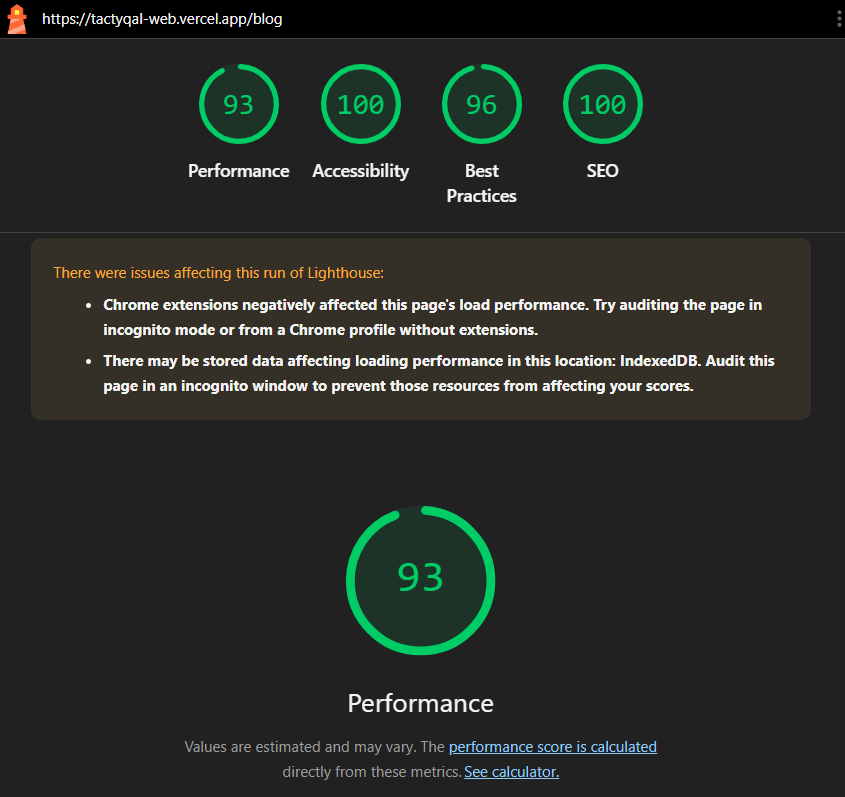
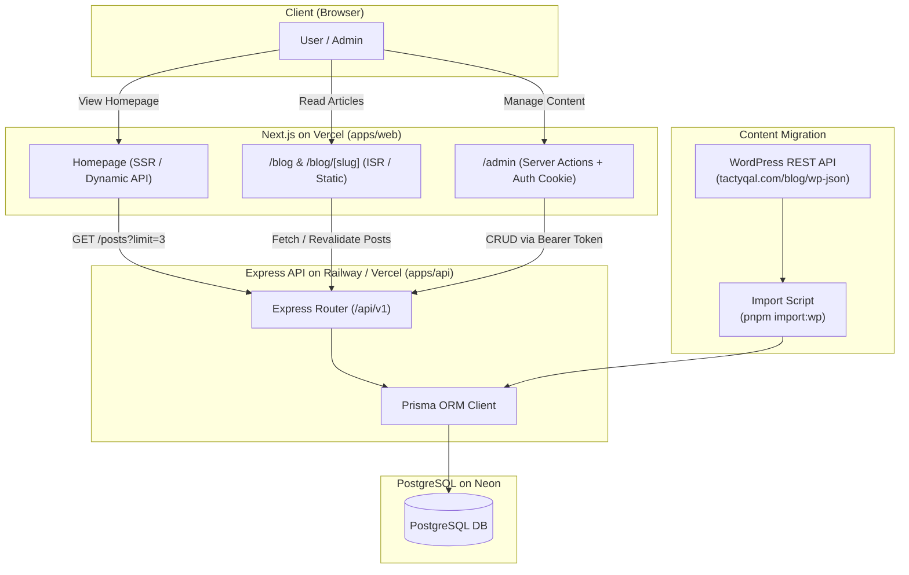
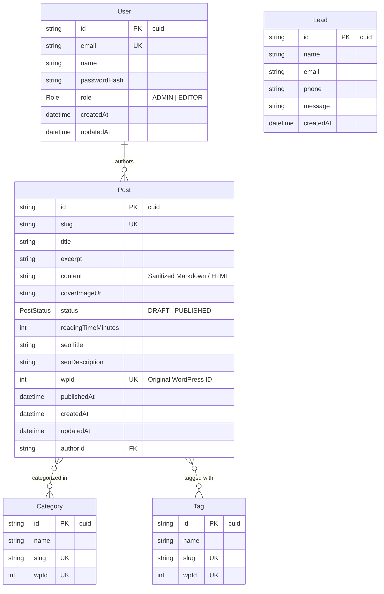

# Tactyqal Labs

> One modern codebase replacing Tactyqal's CodeIgniter site and WordPress blog.

---

## Live Deployments

| Resource | URL | Notes / Credentials |
| --- | --- | --- |
| **Website** | [tactyqal-web.vercel.app](https://tactyqal-web.vercel.app) | Production marketing homepage |
| **Blog** | [tactyqal-web.vercel.app/blog](https://tactyqal-web.vercel.app/blog) | Public blog with ISR & category filtering |
| **Admin Panel** | [tactyqal-web.vercel.app/admin/login](https://tactyqal-web.vercel.app/admin/login) | Demo credentials: `admin@tactyqal.com` / `admin123` |
| **API Docs (Swagger)** | [tactyqal-labs-phi.vercel.app/api/docs](https://tactyqal-labs-phi.vercel.app/api/docs) | Interactive OpenAPI 3.0 / Swagger UI |
| **Video Walkthrough** | [Watch Walkthrough (Loom / YouTube)](#) | Placeholder (90-second product demo) |

---

## Screenshots

| Desktop Homepage | Mobile Responsive |
| :---: | :---: |
|  |  |

| Blog Listing & Articles | Admin Editor |
| :---: | :---: |
|  |  |

| Swagger API Docs | Lighthouse Audit |
| :---: | :---: |
|  |  |

---

## What I Built

### Task 1: Redesigned Homepage
- **1:1 Content Accuracy**: Faithful replication of live tactyqal.com content stored in a strictly typed schema (`apps/web/src/content/site.ts`).
- **Custom Design System**: Warm, editorial aesthetic (inspired by Brilliant.org & Linear) using custom CSS tokens (`--brand: #F2541B`, `--brand-soft: #FFF1EB`, `--bg: #FAFAF7`) and Bricolage Grotesque + Geist Sans typography.
- **Asset-Free Mockups**: Pure CSS/SVG device mockups (KrishiDrishti and Converza preview windows) avoiding raster stock image clutter.
- **Dynamic API Integration**: "From the blog" section dynamically hydrates from the Express API with graceful fallback skeleton loading.
- **Lead Capture Flow**: Validated consultation booking form posting directly to `/api/v1/leads` with rate limiting and toast feedback.

### Task 2: Custom Blog Platform & API
- **Express + Prisma + Neon PostgreSQL**: Production REST API with connection-pooling retry resilience for serverless Neon cold starts.
- **Public Blog with ISR**: Next.js App Router with Incremental Static Regeneration (`revalidate: 60`), category/tag filtering, search, and dynamic OpenGraph/SEO tags.
- **Admin CMS Dashboard**: Protected `/admin` area using secure `httpOnly` cookie auth, complete post lifecycle (Draft/Published), and a rich Markdown editor.
- **WordPress Importer**: CLI tool (`import:wp`) migrating posts from the live WordPress REST API, converting HTML to Markdown, and performing idempotent upserts.

---

## Architecture



---

## Why This Beats the Current Setup (WordPress + CodeIgniter)

1. **One Codebase & Unified Design System**: Consolidates separate PHP CodeIgniter and WordPress instances into a single TypeScript monorepo, sharing styling tokens, types, and component primitives.
2. **Superior Performance (ISR/Static)**: Pre-rendered static pages at the edge with background revalidation eliminate database trips on every page load, unlike PHP-driven page rendering.
3. **Full SEO Control**: Dynamic OpenGraph image generation, automatic `sitemap.xml` and `robots.txt`, and clean semantic markup without cumbersome SEO plugins.
4. **Zero Plugin Attack Surface**: Eliminates WordPress vulnerability vectors, unmaintained third-party plugins, and database bloat with standard Zod validation, Helmet security headers, and parameterized Prisma queries.
5. **Typed REST API for Future Clients**: Clean OpenAPI/Swagger-documented endpoints ready for consumption by mobile applications or external syndication.
6. **Frictionless Migration via Import Script**: Automated script transforms WordPress HTML into clean, portable Markdown with resilient pagination and zero data loss.

---

## Design Decisions

- **Target Audience**: Designed for a dual audience — **Parents of teens** (buyers looking for trust, academic credibility, and university admission outcomes) and **Teens** (builders inspired by modern tech, startup energy, and autonomy).
- **Color & Typography**:
  - Warm editorial palette: neutral parchment background (`--bg: #FAFAF7`, `--surface: #FFFFFF`), crisp dark ink (`--ink: #0E0E12`), energetic brand orange (`--brand: #F2541B`), and subtle highlight yellow (`--accent: #FFD66B`).
  - Exactly one dark band reserved for the high-converting final CTA section.
  - Heading font: **Bricolage Grotesque** (600–700 weight, tight tracking) for punchy editorial character; body font: **Geist Sans** for clean legibility.
- **Accessibility (a11y)**:
  - Semantic HTML landmarks (`<header>`, `<main>`, `<section>`, `<footer>`) with a single `<h1>` hierarchy per page.
  - High-contrast visible focus rings on all interactive elements.
  - Full keyboard accessibility for modal dialogs and accordion disclosures.
  - Color contrast exceeds WCAG AA standards.
  - Respects `prefers-reduced-motion` across all entrance and hover animations.

---

## Tech Stack

| Layer | Technology | Details |
| --- | --- | --- |
| **Workspace** | pnpm Workspaces | Monorepo orchestrating `apps/web` and `apps/api` |
| **Frontend** | Next.js 15 (App Router), React 19 | Server Components, Server Actions, ISR, TypeScript |
| **Styling & UI** | Tailwind CSS v4, shadcn/ui, Radix UI | Custom design tokens, accessible UI primitives, Lucide icons |
| **CMS Editor** | Tiptap Editor | Extensible Markdown and rich-text editing experience |
| **Backend API** | Express 5, TypeScript | Layered modular architecture, Zod validation, Pino logging |
| **Database & ORM** | PostgreSQL (Neon), Prisma 6 | Serverless Postgres, connection pooling, typed migrations |
| **Security & Auth** | JWT, bcryptjs, Helmet, CORS, Rate Limit | Secure httpOnly session cookies, IP-based request throttling |
| **Documentation** | OpenAPI 3.0 / Swagger UI | Self-hosted API documentation served at `/api/docs` |
| **Testing** | Vitest 3, Supertest 7 | Integration test suite for auth, CRUD, validation, resilience |

---

## Data Model



---

## API Reference

Interactive Swagger documentation is available at `/api/docs`.

| Method | Route | Auth | Description |
| --- | --- | --- | --- |
| `GET` | `/api/v1/health` | Public | System health check & database ping |
| `GET` | `/api/docs` | Public | Interactive Swagger UI API documentation |
| `GET` | `/api/openapi.json` | Public | OpenAPI 3.0 specification JSON |
| `POST` | `/api/v1/auth/login` | Public | Admin login (`email`, `password`), returns JWT (rate limited) |
| `GET` | `/api/v1/auth/me` | Admin | Get currently authenticated admin user profile |
| `GET` | `/api/v1/posts` | Public* | List posts with pagination, search, category, tag (*Admin sees drafts) |
| `GET` | `/api/v1/posts/:slug` | Public* | Get full single post by slug (*Drafts require Admin) |
| `POST` | `/api/v1/posts` | Admin | Create blog post with auto-slug, excerpt, reading time |
| `PATCH` | `/api/v1/posts/:id` | Admin | Update post fields, auto-recalculates reading time |
| `DELETE` | `/api/v1/posts/:id` | Admin | Delete post by ID (returns `204 No Content`) |
| `GET` | `/api/v1/categories` | Public | List all categories with published post counts |
| `POST` | `/api/v1/categories` | Admin | Create a new category |
| `GET` | `/api/v1/tags` | Public | List all tags with published post counts |
| `POST` | `/api/v1/tags` | Admin | Create a new tag |
| `POST` | `/api/v1/leads` | Public | Submit homepage contact / consultation lead (rate limited) |
| `GET` | `/api/v1/leads` | Admin | View submitted leads with pagination |

---

## Local Setup

### Prerequisites
- Node.js 20+ (Node 22 recommended)
- `pnpm` 9+
- PostgreSQL database (local or Neon serverless instance)

### 1. Clone & Install
```bash
git clone <repo-url>
cd DevutyAssignment
pnpm install
```

### 2. Configure Environment Variables
Copy the `.env.example` templates in each app:
```bash
cp apps/api/.env.example apps/api/.env
cp apps/web/.env.example apps/web/.env
```

Key environment variables:
- **`apps/api/.env`**:
  - `DATABASE_URL`: PostgreSQL connection string (pooled)
  - `DIRECT_URL`: PostgreSQL connection string (direct, for migrations)
  - `JWT_SECRET`: Random 64+ char secret
  - `CORS_ORIGINS`: `http://localhost:3000`
  - `ADMIN_EMAIL`: Initial admin login
  - `ADMIN_PASSWORD`: Initial admin password (min 10 chars)
- **`apps/web/.env`**:
  - `API_URL`: `http://localhost:4000` (server-side calls)
  - `NEXT_PUBLIC_API_URL`: `http://localhost:4000` (browser-side calls)
  - `NEXT_PUBLIC_SITE_URL`: `http://localhost:3000`

### 3. Migrate & Seed Database
```bash
# Apply Prisma schema migrations
pnpm --filter api db:migrate

# Seed admin user, categories, tags, and sample posts
pnpm --filter api db:seed
```

### 4. Run WordPress Importer (Optional)
Import legacy posts, categories, tags, and featured images directly from the WordPress REST API:
```bash
pnpm --filter api import:wp
```

### 5. Start Development Servers
```bash
pnpm dev
```
- **Web**: [http://localhost:3000](http://localhost:3000)
- **API**: [http://localhost:4000](http://localhost:4000)
- **Swagger Docs**: [http://localhost:4000/api/docs](http://localhost:4000/api/docs)

---

## Testing

The API includes automated integration tests covering authentication, route authorization, CRUD operations, taxonomy linking, and database retry handling:

```bash
# Run all tests
pnpm test

# Run tests in watch mode
pnpm --filter api test:watch

# Code formatting and lint checks
pnpm lint
pnpm format:check
pnpm --filter web typecheck
pnpm --filter api typecheck
```

---

## Project Structure

```text
├── apps/
│   ├── api/                     # Express REST backend
│   │   ├── prisma/              # Database schema & migrations
│   │   │   ├── migrations/
│   │   │   └── schema.prisma
│   │   ├── src/
│   │   │   ├── lib/             # Prisma client, JWT, OpenAPI spec, utils
│   │   │   ├── middleware/      # Auth, rate-limit, validation, error handler
│   │   │   ├── routes/          # Express route controllers (auth, posts, leads, terms)
│   │   │   ├── schemas/         # Zod input validation schemas
│   │   │   ├── scripts/         # Seed & WordPress importer scripts
│   │   │   ├── test/            # Vitest integration test suites
│   │   │   ├── app.ts           # Express app setup & middleware
│   │   │   └── server.ts        # Server bootstrap listener
│   │   └── package.json
│   │
│   └── web/                     # Next.js 15 App Router frontend
│       ├── public/              # Static assets & icons
│       ├── src/
│       │   ├── app/             # App Router pages (/, /blog, /admin, sitemap)
│       │   │   ├── admin/       # Protected admin panel & post editor
│       │   │   ├── blog/        # Blog listing & ISR dynamic post routes
│       │   │   ├── layout.tsx   # Root layout with fonts & providers
│       │   │   └── page.tsx     # Tactyqal redesigned homepage
│       │   ├── components/      # Modular UI & section components
│       │   │   ├── admin/       # Post form, editor, leads viewer
│       │   │   ├── layout/      # Sticky navbar, footer
│       │   │   ├── sections/    # Hero, stories, timeline, tools, FAQ, etc.
│       │   │   └── ui/          # Accessible shadcn/Radix components
│       │   ├── content/         # Typed homepage content store (site.ts)
│       │   └── lib/             # API client, admin server actions, types
│       └── package.json
│
├── docs/                        # Architecture & deployment runbooks
│   └── DEPLOY.md
├── pnpm-workspace.yaml          # Monorepo workspace configuration
└── README.md                    # Project documentation
```

---

## What I'd Do Next

1. **Direct Cloud Storage Uploads (S3 / Supabase Storage)**: Integrate presigned S3/Supabase upload URLs inside the admin Tiptap editor for self-hosted post media.
2. **Scheduled Post Publishing**: Background worker to automatically publish drafted posts at a user-defined future `publishedAt` timestamp.
3. **Multi-Author RBAC**: Granular permissions distinguishing `Author` (create/edit own drafts), `Editor` (publish/manage all), and `Admin` (manage team & site settings).
4. **PostgreSQL Full-Text Search**: Implement PostgreSQL `tsvector` and GIN indexing for fast, typo-tolerant search across post titles and bodies.
5. **Privacy-Friendly Analytics**: Self-hosted or privacy-first analytics (e.g., Plausible or PostHog) to track article read-through rates and consultation funnel conversion.

